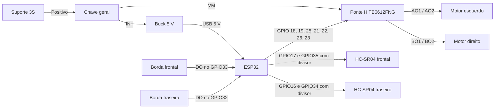

# Diagrama de pinos e alimentação

A frente é o lado para o qual o robô avança. Esquerda e direita são vistas por trás, olhando para a frente.



## Ponte H e motores

| ESP32 ou alimentação | Pino da TB6612FNG | Função |
| --- | --- | --- |
| GPIO18 | AIN1 | Direção do motor esquerdo |
| GPIO19 | AIN2 | Direção do motor esquerdo |
| GPIO25 | PWMA | PWM do motor esquerdo |
| GPIO21 | BIN1 | Direção do motor direito |
| GPIO22 | BIN2 | Direção do motor direito |
| GPIO26 | PWMB | PWM do motor direito |
| GPIO23 | STBY | Habilitação |
| 3V3 | VCC | Alimentação da lógica |
| Positivo após a chave | VM | Alimentação dos motores |
| GND comum | GND | Referência de alimentação e sinais |

Ligue os dois fios do motor esquerdo a **AO1/AO2** e os do direito a **BO1/BO2**. A ordem dos fios define o sentido físico. A polaridade inicial do código segue o sketch autônomo da montagem. Se uma roda girar ao contrário, corrija o par de fios desse motor ou o sinal correspondente em `main/config.h`.

## Sensores

| Módulo | Alimentação | Pinos de sinal |
| --- | --- | --- |
| HC-SR04 frontal | 5 V e GND comum | TRIG → GPIO17. ECHO → divisor → GPIO35 |
| HC-SR04 traseiro | 5 V e GND comum | TRIG → GPIO16. ECHO → divisor → GPIO34 |
| Infravermelho frontal | 3V3 e GND comum | DO → GPIO33. AO livre |
| Infravermelho traseiro | 3V3 e GND comum | DO → GPIO32. AO livre |

Cada ultrassom tem um divisor independente para o ECHO. Com ECHO a 5 V, o nó fica em cerca de 3 V:

```text
ECHO ── 10 kΩ ──┬── GPIO34 ou GPIO35
                └── 15 kΩ ── GND comum
```

Os sensores de borda ficam voltados para o chão. Verifique **preto = 1** e **branco = 0** nos dois sensores, com a altura normal de montagem.

## Chave, baterias e distribuição

- O positivo do suporte passa pela chave geral. Depois da chave, ele vai a **VM** e a **IN+ do buck**.
- O negativo do suporte, **IN− do buck**, ponte H, ESP32 e sensores compartilham o **GND**.
- A saída USB do buck fornece 5 V ao ESP32. O trilho de 5 V alimenta os HC-SR04. Os 3,3 V alimentam o VCC da ponte H e os sensores de borda.
- Três células Li-ion de 3,7 V em série fornecem 11,1 V nominais e chegam a 12,6 V carregadas. Confira a tensão admissível dos motores e do buck antes de conectar VM. O PWM ajusta o ciclo de trabalho e a tensão de pico em VM continua sendo a da alimentação.
- A chave é elétrica e não ocupa um GPIO. O conversor de 5 V serve para alimentação do ESP32.
